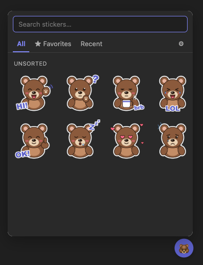

**You miss your We Bare Bears or any other stickers in Teams? We do too.**

# Teams Stickers

Local Chromium (Chrome / Edge / Brave) MV3 extension that adds a 🐻 sticker picker to Microsoft Teams Web.
No build step, no network, everything stays in the extension's IndexedDB.

## Install

1. `chrome://extensions` (or `edge://extensions`) → enable **Developer mode**
2. **Load unpacked** → select this folder
3. Click the extension icon → sticker manager opens → import stickers

## Use

- In Teams, a 🐻 button sits above the message box (or bottom-right if none is found). `Alt+Shift+S` toggles it.
- Search by name / pack / tags; `Enter` sends the first result, `Esc` closes.
- Hover a sticker → ☆ to favorite. Tabs: All / Favorites / Recent.
- Clicking a sticker pastes it into the composer as an image; you then press Enter to send.
  If Teams ignores the synthetic paste, the sticker is copied to the clipboard instead — press `Ctrl+V`.

## Importing Telegram stickers

Get the pack as files (e.g. via a Telegram sticker-download bot, or saving from Telegram Desktop), then drop the
folder onto the manager. The folder name becomes the pack name.

| Format | Support |
| --- | --- |
| PNG, JPG, WebP | yes (WebP converted to PNG on insert) |
| GIF | yes, animated, inserted as-is |
| WebM (video stickers) | first frame only |
| TGS (animated Lottie) | not yet — convert to GIF/PNG first |

**Insert size** in the manager scales stickers down before pasting (default 160 px) so they don't show up huge.

## Disclaimer

Unofficial project, not affiliated with or endorsed by Microsoft or Cartoon Network.
No stickers are included — you import your own.
We Bare Bears is a trademark of Cartoon Network. The bear art in this repo (`icons/`, `art/`) is original and MIT-licensed.
Microsoft Teams is a trademark of Microsoft Corporation.
